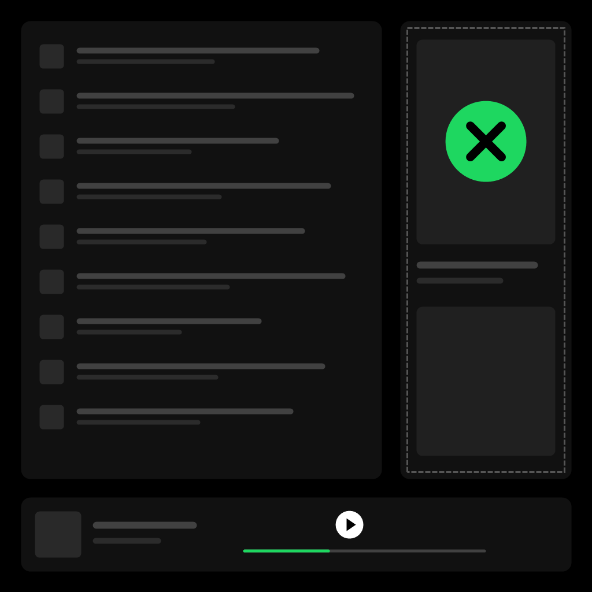

# Stay Closed



Stop Spotify's Now Playing view from popping open on its own. It still opens when you ask for it.

A [Spicetify](https://spicetify.app) extension.

## ✨ What it does

- Closes the Now Playing view whenever Spotify opens it by itself (on song change, on startup, when a video starts).
- Leaves it alone when **you** open it. Click the cover art in the bottom bar and it stays open until you close it.
- Adds a **Stay Closed** toggle to the profile menu so you can switch it off without uninstalling.

## 📦 Install

### Marketplace

Open the [Spicetify Marketplace](https://github.com/spicetify/marketplace), search for **Stay Closed** and click install.

### Manual

1. Download [`stayClosed.js`](stayClosed.js) into your Spicetify `Extensions` folder.

   | Platform        | Path                              |
   | --------------- | --------------------------------- |
   | **Windows**     | `%appdata%\spicetify\Extensions\` |
   | **Linux/macOS** | `~/.config/spicetify/Extensions/` |

2. Run:

   ```
   spicetify config extensions stayClosed.js
   spicetify apply
   ```

## 🗑️ Uninstall

Remove it from the Marketplace **Installed** tab, or for a manual install run:

```
spicetify config extensions stayClosed.js-
spicetify apply
```

## ⚙️ How it works

The extension watches for the Now Playing view appearing in the right sidebar. If it shows up without a recent click on the cover art or inside the sidebar, it is closed straight away. Opening it yourself marks it as wanted, and it then stays open across tracks.

It also turns off Spotify's own setting **Show the now-playing panel on click of play** (Settings → Display) while it is switched on. Turning Stay Closed off in the profile menu puts that setting back the way you had it.

> [!NOTE]
> Tested on Spotify 1.3.3 with Spicetify 2.45.3. Spotify renames its internal elements from time to time, so a Spotify update can break this until the extension is updated. If the view starts popping up again, please [open an issue](https://github.com/superC12/spicetify-stay-closed/issues) with your Spotify version.

## 📋 Changelog

### v1.1.0

- Now switches off Spotify's own "Show the now-playing panel on click of play" setting while Stay Closed is on, which stops the pop-up at the source. Your original choice is restored when you turn Stay Closed off in the profile menu.

### v1.0.2

- Fixed for Spotify 1.3.4, which keeps the Now Playing view in the page as a collapsed strip: the extension could mistake that strip for an open view and stop closing real pop-ups.
- Clicks on the player bar no longer count as asking for the view.

### v1.0.1

- Fixed the **Stay Closed** toggle not appearing in the profile menu on manual installs.

### v1.0.0

- Initial release.

## License

[MIT](LICENSE)
